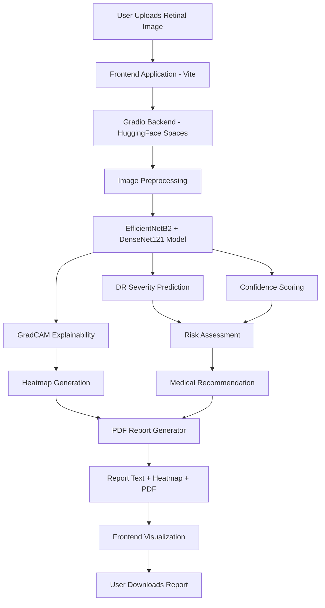
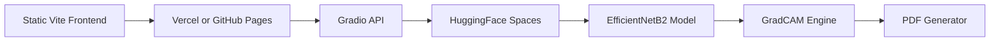
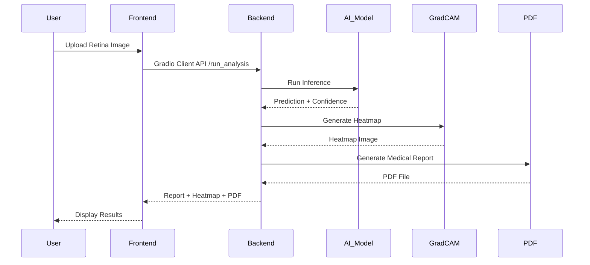

# 👁️ RetaniaScan-AI

## AI-Powered Diabetic Retinopathy Detection System

RetaniaScan-AI is a full-stack AI healthcare platform for automated diabetic retinopathy detection using deep learning, explainable AI, and cloud deployment.

The system combines:

- 🧠 Ensemble retinal classification
- 🔥 GradCAM explainability heatmaps
- 📄 Automated PDF medical reports
- ⚡ Gradio API hosted on Hugging Face Spaces
- 🌐 Static frontend for Vercel and GitHub Pages
- 🤗 HuggingFace AI hosting

---

# 🚀 Features

✅ Diabetic Retinopathy Severity Classification  
✅ EfficientNetB2 + DenseNet121 Deep Learning Model  
✅ Explainable AI using GradCAM  
✅ Confidence Score Analysis  
✅ Risk Level Prediction  
✅ Automated Medical Recommendations  
✅ PDF Medical Report Generation  
✅ Gradio Client API
✅ HuggingFace Spaces Deployment  
✅ Vercel and GitHub Pages Frontend Support
✅ Full AI Workflow Integration  

---

# 🧠 AI Model Information

| Component | Details |
|---|---|
| Model | EfficientNetB2  + DenseNet121|
| Framework | PyTorch |
| Classes | 5 |
| Explainability | GradCAM |
| Backend | Gradio |
| Frontend | Vite + JavaScript |
| Backend Hosting | HuggingFace Spaces |
| Frontend Hosting | Vercel or GitHub Pages |

---

# 🏗️ Complete System Architecture



---

# 🌐 Full Stack Deployment Architecture



---

# 🔄 Complete Data Flow



---

# 📁 Project Structure

```text
retaniascan-ai/
│
├── app/
│   ├── config.py
│   ├── gradcam.py
│   ├── inference.py
│   ├── main.py
│   ├── report_generator.py
│   └── utils.py
│
├── dataset/
│
├── models/
│   ├── efficientnet/
│   └── densenet121/
│
├── notebooks/
│
├── outputs/
│
├── scripts/
│
├── frontend/
│
├── app.py
├── requirements.txt
└── README.md
```

---

# 🔥 GradCAM Explainability

RetaniaScan-AI uses GradCAM to visualize retinal regions that influenced the AI model's prediction.

### Heatmap Interpretation

| Color | Meaning |
|---|---|
| 🔴 Red | Highest influence |
| 🟠 Orange | Strong influence |
| 🟢 Green | Moderate influence |
| 🔵 Blue | Low influence |

This improves:
- AI transparency
- Clinical interpretability
- Medical trustworthiness

---

# 📄 PDF Medical Reports

The system automatically generates downloadable PDF reports containing:

- Uploaded retinal image
- DR severity prediction
- Confidence score
- Risk level
- GradCAM heatmap
- AI recommendation
- Timestamp
- Disclaimer

---

# ⚙️ Local Gradio Setup

## 1. Create and activate a virtual environment (Windows)

```powershell
py -3.10 -m venv .venv
.\.venv\Scripts\Activate.ps1
```

## 2. Install dependencies and model weights

```bash
pip install -r requirements.txt
```

The model files are not tracked in Git. From the repository root, download the
same weights used by the Hugging Face Space:

```powershell
New-Item -ItemType Directory -Force models\efficientnet, models\densenet121 | Out-Null
Invoke-WebRequest https://huggingface.co/spaces/01mayankk/RetinaScanAI/resolve/main/models/efficientnet/best_efficientnet_b2.pth -OutFile models\efficientnet\best_efficientnet_b2.pth
Invoke-WebRequest https://huggingface.co/spaces/01mayankk/RetinaScanAI/resolve/main/models/densenet121/best_densenet121_phase2.pth -OutFile models\densenet121\best_densenet121_phase2.pth
```

Run the app from the repository root:

```bash
python app.py
```

Open `http://127.0.0.1:7860`. The Gradio endpoint is `/predict`; API details are
available at `http://127.0.0.1:7860/gradio_api/info`.

# 🌐 Frontend Setup and Deployment

The frontend uses the official `@gradio/client` SDK and connects directly to the
public `01mayankk/RetinaScanAI` Space at `/run_analysis`. No Hugging Face token
or client-side secret is required. The `VITE_*` settings are public build-time
configuration, not secret storage. To use the local app instead, set
`VITE_GRADIO_SPACE=http://127.0.0.1:7860` and
`VITE_GRADIO_API_NAME=/predict` in `frontend/.env.local`.

Run locally:

```powershell
cd frontend
npm install
Copy-Item .env.example .env.local
npm run dev
```

Create a production build with `npm run build`; the output is `frontend/dist`.
`VITE_BASE_PATH` configures the Vite base path and defaults to `./`, which works
for Vercel and repository-path GitHub Pages deployments.

## Deploy to Vercel

Import the repository into Vercel with the repository root as the project root.
The root `vercel.json` installs the frontend dependencies, runs the Vite build,
and publishes `frontend/dist`. Deploy from the repository root:

```bash
npx vercel --prod
```

The Space and `/run_analysis` endpoint are defaults in the frontend. If you
override them in Vercel, configure `VITE_GRADIO_SPACE` and
`VITE_GRADIO_API_NAME` as public build variables. Do not add `HF_TOKEN` or
other secrets to frontend environment variables or source files.

For GitHub Pages, set the repository's Pages source to **GitHub Actions**. The
included workflow builds and deploys `frontend/dist` on pushes to `main`:

```bash
git add frontend .github/workflows/frontend-pages.yml README.md .gitignore app.py requirements.txt
git commit -m "Add RetinaScanAI frontend"
git push origin main
```

The frontend renders the Gradio outputs as returned: report text (including
prediction, top-two confidence values, risk, confidence status, recommendation,
and disclaimer), Grad-CAM image, and PDF file. The API does not return a
per-class probability vector.

---

# 📊 Gradio API Contract

`/run_analysis` on the currently deployed Space accepts one image input named
`image` and returns three outputs in order: report text, a Grad-CAM image file,
and a PDF report file. The local app exposes the same input/output contract at
`/predict`.

---

# 🔐 Security & Disclaimer

⚠️ This project is designed for:

- Educational purposes
- AI research
- Demonstration systems

It is NOT intended to replace professional medical diagnosis.

Always consult certified ophthalmologists for clinical decisions.

---

# 🔮 Future Improvements

- Multi-model AI ensemble
- Retina image quality assessment
- User authentication
- Patient history dashboard
- ONNX optimization
- GPU acceleration
- Cloud database integration
- Multi-language support
- Mobile application

---

# 👨‍💻 Developer

## Mayank Kumar

RetaniaScan-AI — AI-Powered Retinal Screening System

---
