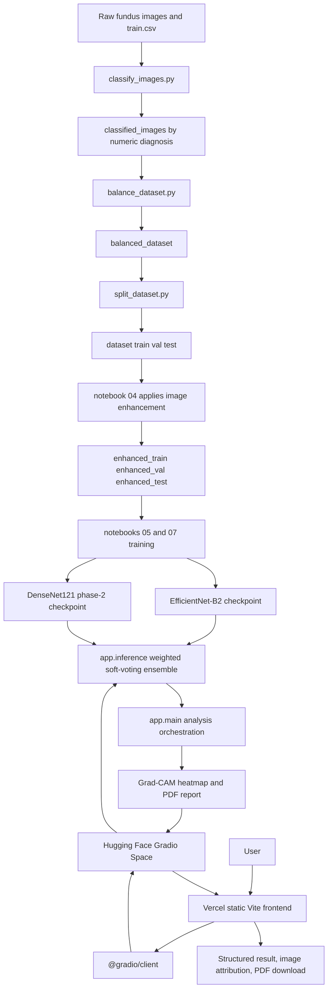

# RetinaScan AI

RetinaScan AI is a research and triage-support demonstration for five-stage diabetic retinopathy (DR) screening from fundus photographs. A Vite frontend submits an image to a public Gradio Space; the backend returns a text report, a Grad-CAM overlay, and a downloadable PDF.

> **Clinical limitation:** This project is not a medical device and does not diagnose, rule out, or treat disease. Outputs are for education and research triage support only and require review by a licensed ophthalmologist.

## Live services

- **Hugging Face Space:** [01mayankk/RetinaScanAI](https://huggingface.co/spaces/01mayankk/RetinaScanAI)
- **Vercel frontend:** deployment is configured in [`vercel.json`](./vercel.json), but a verified RetinaScan AI deployment URL is not recorded in this repository. The candidate `retinascan-ai.vercel.app` currently serves an unrelated Next.js starter, so it is intentionally not linked. Add the correct deployment URL here when available.

The browser connects to the public Space through `@gradio/client` without a Hugging Face token. The frontend returns only the report, heatmap, and PDF provided by the API; the API does not expose a per-class probability vector.

## System architecture



The source connection is present: notebook 04 maps each script-generated split (`train`, `val`, `test`) to its corresponding `enhanced_*` directory, applies `enhance_retina_image`, and saves the result. Notebooks 05 and 07 load those enhanced outputs. `scripts/pipeline_summary.py` inspects this mapping and local file counts without modifying data or model artifacts.

## Five DR grades

| Index | Class |
|---:|---|
| 0 | No DR |
| 1 | Mild DR |
| 2 | Moderate DR |
| 3 | Severe DR |
| 4 | Proliferative DR |

The live inference transform converts the image to RGB, resizes it to 300 × 300, and applies ImageNet normalization. It combines DenseNet121 probabilities (weight 0.6) with EfficientNet-B2 probabilities (weight 0.4). Grad-CAM is generated using the final DenseNet121 feature layer.

## Repository map

```text
.
├── .github/
│   └── workflows/frontend-pages.yml      # Optional GitHub Pages build/deploy
├── app.py                                # Gradio UI and /predict API
├── app/
│   ├── __init__.py
│   ├── config.py                         # Labels, model paths, ensemble settings
│   ├── inference.py                      # Two-model inference and report fields
│   ├── gradcam.py                        # DenseNet121 Grad-CAM overlay
│   ├── main.py                           # Inference, heatmap, PDF orchestration
│   ├── report_generator.py               # Timestamped PDF creation
│   ├── app_utils.py                      # Empty placeholder
│   └── utils.py                          # Empty placeholder
├── frontend/
│   ├── index.html                        # Screening interface and dialogs
│   ├── src/main.js                       # Gradio client, upload, parsing, rendering
│   ├── src/style.css                     # Clinical UI styles and interactions
│   ├── package.json                      # Vite and @gradio/client scripts
│   ├── package-lock.json
│   ├── vite.config.js                    # Base-path configuration
│   ├── .env.example                      # Public client configuration example
│   └── README.md                         # Frontend/API/deployment guide
├── notebooks/
│   ├── 00_gpu_test.ipynb
│   ├── 01_dataset_visualization.ipynb
│   ├── 02_dataloader_testing.ipynb
│   ├── 03_augmentation_testing.ipynb
│   ├── 04_image_quality_enhancement.ipynb
│   ├── 05_efficientnet_training.ipynb
│   ├── 06_gradcam_testing.ipynb
│   ├── 07_densenet121_training.ipynb
│   ├── 08_model_comparison.ipynb
│   ├── 09_ensemble_inference.ipynb
│   └── retinascan_experimentation.ipynb  # Empty file
├── scripts/
│   ├── pipeline_summary.py              # Read-only source/data/model audit CLI
│   ├── preprocessing/
│   │   ├── classify_images.py
│   │   ├── balance_dataset.py
│   │   ├── split_dataset.py
│   │   ├── count_images.py
│   │   └── count_balanced_dataset.py
│   ├── training/                         # Five empty Python placeholders
│   │   ├── evaluate_model.py
│   │   ├── inference.py
│   │   ├── metrics.py
│   │   ├── test_model.py
│   │   └── train_model.py
│   └── utils/                            # Three empty Python placeholders
│       ├── config.py
│       ├── dataset_utils.py
│       └── image_utils.py
├── models/                               # Local checkpoints (not tracked by Git)
├── outputs/                              # Runtime heatmaps and generated reports
├── README.md
├── README_BACKEND.md                     # Backend and ML pipeline guide
├── docs/
│   ├── ARCHITECTURE.md
│   ├── DATAFLOW.md
│   ├── DECISIONS.md
│   ├── PROJECT_STATUS.md
│   ├── FILE_GUIDE.md
│   └── ONBOARDING.md
├── .gitignore
├── check_gpu.py
├── requirements.txt                      # Python runtime dependencies
├── setup_project_structure.py
└── vercel.json                           # Vercel frontend build configuration
```

The source-controlled file-by-file reference is in [`docs/FILE_GUIDE.md`](./docs/FILE_GUIDE.md). Dataset files and model weights are local assets and are not committed.

## Quickstart

### Run the Gradio backend locally

Use Python 3.10 or later. From the repository root in PowerShell:

```powershell
py -3.10 -m venv .venv
.\.venv\Scripts\Activate.ps1
pip install -r requirements.txt
New-Item -ItemType Directory -Force models\efficientnet, models\densenet121 | Out-Null
Invoke-WebRequest https://huggingface.co/spaces/01mayankk/RetinaScanAI/resolve/main/models/efficientnet/best_efficientnet_b2.pth -OutFile models\efficientnet\best_efficientnet_b2.pth
Invoke-WebRequest https://huggingface.co/spaces/01mayankk/RetinaScanAI/resolve/main/models/densenet121/best_densenet121_phase2.pth -OutFile models\densenet121\best_densenet121_phase2.pth
python app.py
```

The local Gradio server listens on `http://127.0.0.1:7860`; `app.py` registers the API as `/predict`. API details are available at `http://127.0.0.1:7860/gradio_api/info`.

### Run and build the frontend

```powershell
cd frontend
npm ci
Copy-Item .env.example .env.local
npm run dev
```

The example frontend configuration targets the public Space and its `/run_analysis` endpoint. To use the local backend, set these values in `frontend/.env.local`:

```dotenv
VITE_GRADIO_SPACE=http://127.0.0.1:7860
VITE_GRADIO_API_NAME=/predict
VITE_BASE_PATH=./
```

Create and verify the production bundle with:

```powershell
npm run build
```

No `HF_TOKEN` or other API key belongs in frontend source or public `VITE_*` settings. The Space is public and the frontend uses its unauthenticated client connection.

## Deployment

For Vercel, set the project Root Directory to `frontend`. The repository [`vercel.json`](./vercel.json) then runs `npm ci`, builds with `npm run build`, and serves `dist` from that directory. Add the verified deployment URL to the Live services section after deployment.

The optional GitHub Pages workflow is [`frontend-pages.yml`](./.github/workflows/frontend-pages.yml). The Vite `VITE_BASE_PATH` setting supports repository-path hosting.

## Dataset and model provenance

- `scripts/preprocessing/classify_images.py` copies CSV-labeled PNG files into numeric class folders.
- `balance_dataset.py` targets 300 files per class by random undersampling or image augmentation. `split_dataset.py` then performs per-class random 70/15/15 file splitting.
- Augmentation happens before that split, without a source-image grouping step; related copies could cross split boundaries.
- Notebook 04 applies CLAHE and conditional sharpening to the script-generated `train/val/test` splits and writes `enhanced_train/enhanced_val/enhanced_test`; notebooks 05 and 07 consume those paths.
- Run `python scripts/pipeline_summary.py` for a concise local split/class table; use `python scripts/pipeline_summary.py --technical` for source-derived training settings, verified path mappings, and model-file metadata. See [`README_BACKEND.md`](./README_BACKEND.md) for details.
- Stored notebook output reports 68.89% EfficientNet-B2 accuracy with test-time augmentation, 68.00% DenseNet121 accuracy, and 70.22% ensemble accuracy. These are historical notebook outputs, not independently reproduced results or clinical performance guarantees.

## Further reading

- [Backend and ML pipeline](./README_BACKEND.md)
- [Frontend architecture and deployment](./frontend/README.md)
- [Architecture](./docs/ARCHITECTURE.md)
- [Dataflow](./docs/DATAFLOW.md)
- [Architectural decisions](./docs/DECISIONS.md)
- [Project status and limitations](./docs/PROJECT_STATUS.md)
- [File guide](./docs/FILE_GUIDE.md)
- [Developer onboarding](./docs/ONBOARDING.md)
