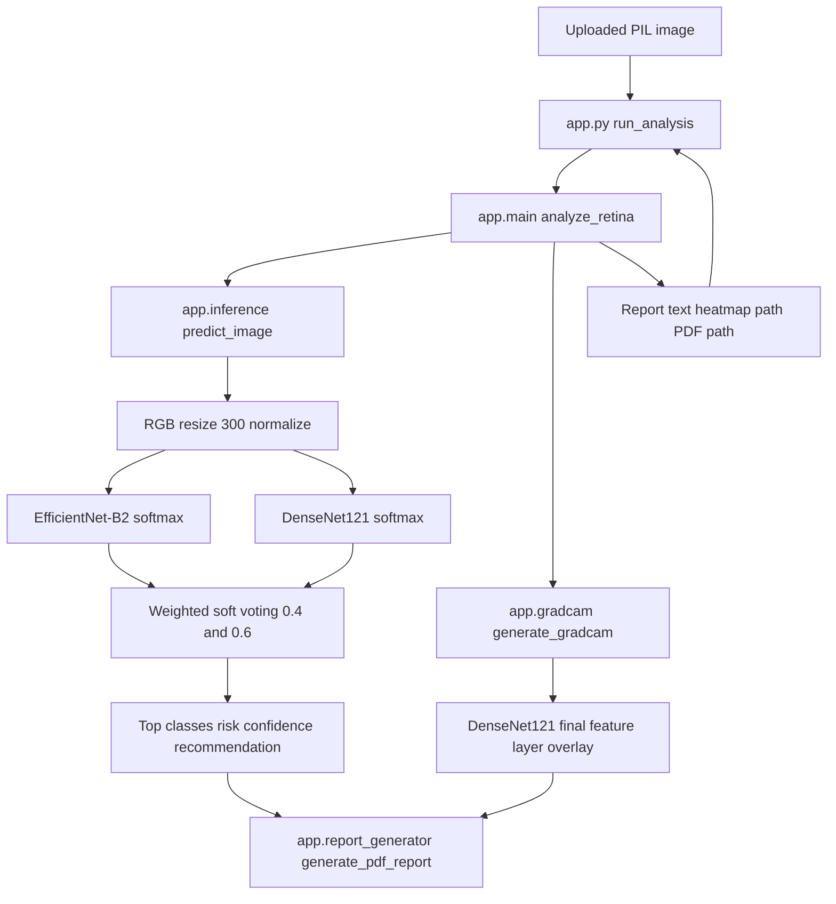

# Backend and ML pipeline

This guide describes what is present in the repository, separating executable preprocessing code, notebook training experiments, and the deployed inference path. A directory name or notebook output is not treated as proof of data lineage unless the code shows the connection.

## Backend architecture

## Offline data and training flow

```mermaid
flowchart LR
    CSV[dataset train.csv] --> C[scripts preprocessing classify_images.py]
    RAW[dataset raw_images PNGs] --> C
    C --> CL[classified_images numeric folders]
    CL --> B[scripts preprocessing balance_dataset.py]
    B --> BAL[balanced_dataset target 300 per class]
    BAL --> S[scripts preprocessing split_dataset.py]
    S --> SPLIT[dataset train val test]
    ENH[dataset enhanced_train enhanced_val enhanced_test] -. "origin not established in checked-in code" .-> E[notebooks 05 EfficientNet and 07 DenseNet]
    E --> MW[model checkpoint files]
    MW --> INF[app.inference loads two checkpoints]
    SPLIT -. "no checked-in transformation to enhanced_*" .-> ENH
```

### Preprocessing implementation

1. **Label-to-folder copy — `scripts/preprocessing/classify_images.py`:** Reads `../../dataset/train.csv`; for each `id_code`, looks for `<id_code>.png` under `../../dataset/raw_images` and copies it to `../../dataset/classified_images/<diagnosis>/`. It creates folders `0` through `4`, counts missing files, and does not decode or validate image contents.
2. **Balancing — `scripts/preprocessing/balance_dataset.py`:** Targets 300 image files per class. Classes with at least 300 images are randomly sampled down to 300. For smaller classes it copies originals, then samples source images and saves random horizontal flips, rotations up to 20 degrees, and brightness/contrast jitter of 0.2 until the target is reached. The random generator is not seeded. Existing output folders are not cleared first, so repeated runs may retain stale files.
3. **Splitting — `scripts/preprocessing/split_dataset.py`:** Separately shuffles each class folder with `random.shuffle`, then copies integer-truncated 70% / 15% / remainder slices to `dataset/train`, `dataset/val`, and `dataset/test`. It has no fixed seed, group-aware split, or explicit duplicate-source exclusion. Because balancing precedes splitting, augmented relatives could land in different splits.
4. **Counting:** `count_images.py` counts supported image extensions in `classified_images`; `count_balanced_dataset.py` counts the same extensions in `balanced_dataset`. Neither changes data.

The class mapping used for inference is defined in `app/config.py`: 0 No DR, 1 Mild DR, 2 Moderate DR, 3 Severe DR, 4 Proliferative DR. The dataset itself is not included, so the original per-class distribution cannot be reported from this repository. If balancing produces exactly 300 files in each class, the scripted split nominally results in 210 / 45 / 45 per class (1,050 / 225 / 225 total). These are conditional arithmetic, not a verified count of a particular dataset run.

### Notebook and dataset lineage caveat

The training notebooks `05_efficientnet_training.ipynb` and `07_densenet121_training.ipynb` load `../dataset/enhanced_train`, `../dataset/enhanced_val`, and `../dataset/enhanced_test`. Their stored outputs show 1,050 / 225 / 225 items. The checked-in scripts instead produce `train`, `val`, and `test`, and no checked-in script maps those folders to `enhanced_*`. Notebook 04 explores image enhancement but does not establish that it generated the training directories. Therefore the notebook counts and scores must not be presented as a verified result of the scripted preprocessing pipeline.

Notebook 04 demonstrates CLAHE on the LAB lightness channel (clip limit 2.0, tile grid 8 × 8) and sharpening when Laplacian variance is below 100. The live inference path does not call these steps; it only converts to RGB, resizes to 300 × 300, tensors, and normalizes with ImageNet means and standard deviations.

## Training notes and evaluation evidence

### EfficientNet-B2 — notebook 05

- Uses torchvision EfficientNet-B2 with default pretrained weights, freezes feature layers, then unfreezes the final two feature blocks; the classifier uses dropout 0.4 and five outputs.
- Training images are resized to 300 × 300 and augmented with random flip, rotation, affine, color jitter, and blur transforms. Validation/test use deterministic resize and ImageNet normalization.
- An earlier notebook cell defines Focal Loss, but the executed optimizer setup later replaces the criterion with `CrossEntropyLoss`; the executed training loop therefore uses cross-entropy.
- Active setup uses AdamW at learning rate `1e-4`, `ReduceLROnPlateau` (patience 3, factor 0.5), at most 100 epochs, and early stopping after 15 epochs without validation-loss improvement. The best-validation-loss checkpoint is written as `models/efficientnet/best_efficientnet_b2.pth`.
- The stored TTA test output reports 68.89% accuracy on the notebook test loader. It is historical notebook output and has not been independently reproduced as part of this documentation task.

### DenseNet121 — notebook 07

- Uses a five-class DenseNet121 classifier with dropout 0.4 and 0.3 in its added classifier layers.
- Training runs in three phases: phase 1 trains the classifier with feature extraction (15 epochs, configured learning rate `1e-3`); phase 2 unfreezes `transition3` and `denseblock4` (up to 30 epochs, learning rate `1e-4`); phase 3 unfreezes the full model (up to 55 epochs, learning rate `5e-6`).
- Phases use cross-entropy and `ReduceLROnPlateau`; early stopping patience is 15. Phase 3 configures label smoothing 0.1 and Adam weight decay `1e-4`.
- `app/inference.py` loads `models/densenet121/best_densenet121_phase2.pth`, not the notebook's phase-3 final checkpoint. The notebook's stored phase-2 test output reports 68.00% accuracy.

No class-weighted loss is configured in these active training cells. Balance handling is implemented by the separate random undersampling/augmentation script; its connection to the `enhanced_*` notebook inputs is unverified.

Notebook 08 compares the two checkpoints. Notebook 09 implements weighted soft voting with DenseNet121 0.6 and EfficientNet-B2 0.4; its stored test output reports 70.22% ensemble accuracy. All three percentages are historical notebook outputs, dependent on the notebook test data and execution state, not clinical validation claims.

## Runtime inference and API contract

`app.py` builds the Gradio interface. Its click handler is registered with `api_name="predict"` and its local launch binds to `0.0.0.0:7860`. The frontend example targets the public Space's `/run_analysis`; a local frontend should set `VITE_GRADIO_API_NAME=/predict`.

The API accepts one image and returns three values in order:

1. A text report with prediction, confidence, second likely class, risk level, confidence status, recommendation, and disclaimer.
2. The generated Grad-CAM image path.
3. A timestamped PDF report path.

`app.inference.predict_image` applies softmax independently to both models, computes the weighted probability sum, and returns the two highest classes. A confidence below 65% is labeled low confidence. It does not expose a full probability vector. Although `app/config.py` contains model-path and ensemble-weight values, `app/inference.py` currently defines its own copies of those constants; keep both locations aligned when changing deployment configuration.

`app.gradcam.generate_gradcam` uses `densenet_model.features[-1]` and saves the overlay to `outputs/heatmaps/latest_gradcam.png`. The function receives `predicted_class`, but the current Grad-CAM call does not pass it as an explicit target. `app.main.analyze_retina` saves the input to `outputs/heatmaps/latest_input.png`, then creates the report and PDF. These runtime paths use fixed `latest_*` filenames.

## File-by-file connections

### Application

| File | Responsibility and connections |
|---|---|
| `app.py` | Gradio page, input validation, `/predict` API registration, queue, and local server launch. Calls `app.main.analyze_retina`. |
| `app/config.py` | Class labels, recommendation strings, risk levels, 300-pixel input size, 65% confidence threshold, model paths, and ensemble weights. |
| `app/inference.py` | Loads EfficientNet-B2 and DenseNet121 checkpoints, preprocesses input, performs weighted soft-voting inference, and returns the top two results. |
| `app/gradcam.py` | Uses the DenseNet121 final feature layer and shared inference preprocessing to create an overlay image. |
| `app/main.py` | Orchestrates inference, input persistence, Grad-CAM, report text, and PDF generation. |
| `app/report_generator.py` | Builds a timestamped PDF using the prediction dictionary, original image, heatmap, and disclaimer. |
| `app/__init__.py` | Package marker. |
| `app/app_utils.py`, `app/utils.py` | Empty placeholders; no active runtime behavior. |

### Preprocessing scripts

| File | Inputs | Outputs / behavior |
|---|---|---|
| `scripts/preprocessing/classify_images.py` | `dataset/train.csv`, `dataset/raw_images/*.png` | Copies labeled images into `dataset/classified_images/<diagnosis>/`. |
| `scripts/preprocessing/balance_dataset.py` | `dataset/classified_images/<class>/` | Copies or augments files into `dataset/balanced_dataset/<class>/`, target 300. |
| `scripts/preprocessing/split_dataset.py` | `dataset/balanced_dataset/<class>/` | Copies class-wise shuffled files into `dataset/train`, `dataset/val`, `dataset/test`. |
| `scripts/preprocessing/count_images.py` | `dataset/classified_images/` | Prints image counts by folder and total. |
| `scripts/preprocessing/count_balanced_dataset.py` | `dataset/balanced_dataset/` | Prints balanced image counts by folder and total. |

### Training and utility placeholders

The following tracked `.py` files are empty and are not the implementation of the model training or inference pipeline; those mechanics are in notebooks and `app/`:

- `scripts/training/train_model.py`
- `scripts/training/inference.py`
- `scripts/training/evaluate_model.py`
- `scripts/training/metrics.py`
- `scripts/training/test_model.py`
- `scripts/utils/config.py`
- `scripts/utils/dataset_utils.py`
- `scripts/utils/image_utils.py`

### Notebook sequence

| Notebook | Checked-in role |
|---|---|
| `00_gpu_test.ipynb` | GPU availability experiment. |
| `01_dataset_visualization.ipynb` | Samples labeled class folders for visualization. |
| `02_dataloader_testing.ipynb` | Tests `ImageFolder`, data loaders, and 224 × 224 transforms for `train/val/test`. |
| `03_augmentation_testing.ipynb` | Visual augmentation experiment. |
| `04_image_quality_enhancement.ipynb` | CLAHE and conditional sharpening experiment; lineage to `enhanced_*` is not shown. |
| `05_efficientnet_training.ipynb` | EfficientNet-B2 training and TTA test evaluation using `enhanced_*`. |
| `06_gradcam_testing.ipynb` | Grad-CAM experiment notebook; separate from runtime `app/gradcam.py`. |
| `07_densenet121_training.ipynb` | Three-phase DenseNet121 training and phase-2 checkpoint evaluation using `enhanced_*`. |
| `08_model_comparison.ipynb` | Compares the two checkpoints on `enhanced_test`. |
| `09_ensemble_inference.ipynb` | Weighted soft-voting experiment on `enhanced_test`. |
| `retinascan_experimentation.ipynb` | Empty, zero-byte notebook file; contains no executable pipeline. |

For browser integration, PDF/report rendering, and Vercel configuration, see [`frontend/README.md`](./frontend/README.md). For setup and user-facing limitations, see [`docs/ONBOARDING.md`](./docs/ONBOARDING.md).
