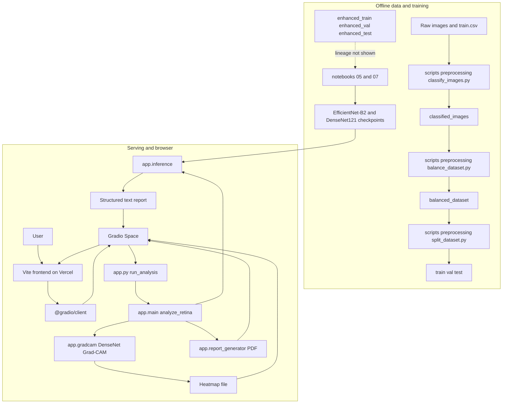

# Architecture

## System boundaries

RetinaScan AI has two separate execution paths:

1. **Offline experimentation:** Python scripts copy, balance, and split a labeled dataset; Jupyter notebooks load datasets, train/evaluate models, and save checkpoints.
2. **Online screening demonstration:** A static Vite frontend sends one image to a Gradio Space. The backend preprocesses it, runs two classifiers, creates a DenseNet121 Grad-CAM overlay and PDF, and returns three outputs.

The checked-in code does not establish that the `train/val/test` folders created by preprocessing scripts are the same dataset lineage as the `enhanced_train/enhanced_val/enhanced_test` paths used by training notebooks.

## Component architecture

## Backend runtime components

- **Gradio interface and API:** `app.py` accepts a PIL image and registers the analysis event as `/predict` for the local server.
- **Inference:** `app/inference.py` loads EfficientNet-B2 and DenseNet121 weights, converts the image to RGB, resizes to 300 × 300, tensors it, and applies ImageNet normalization. It combines softmax probabilities using DenseNet121 weight 0.6 and EfficientNet-B2 weight 0.4.
- **Report:** `app/config.py` maps output indices to five DR classes and provides risk labels, recommendations, and a 65% confidence threshold. `app/main.py` formats the report fields.
- **Explainability:** `app/gradcam.py` targets `densenet_model.features[-1]`, overlays the attribution map, and saves it to `outputs/heatmaps/latest_gradcam.png`.
- **PDF:** `app/report_generator.py` builds a timestamped PDF with result fields, input image, heatmap, disclaimer, and timestamp.

The frontend defaults to the public Space endpoint `/run_analysis`; local use should configure `/predict`. The browser receives report text, a heatmap file, and a PDF file, not a per-class probability array.

## Data and training boundaries

The preprocessing scripts use `dataset/train.csv` and `dataset/raw_images`, then produce `classified_images`, `balanced_dataset`, and `train/val/test`. `notebooks/05_efficientnet_training.ipynb` and `notebooks/07_densenet121_training.ipynb` load `enhanced_*` paths. No checked-in generator or manifest connects those directory sets.

Several tracked files under `scripts/training/` and `scripts/utils/` are empty placeholders. Executable training code is in notebooks, while executable serving code is in `app/`.

## Deployment

`frontend/` is a static Vite application and `vercel.json` directs Vercel to build and serve `frontend/dist`. The browser connects to the public Hugging Face Space through `@gradio/client`; no HF token is required or expected in the frontend.
