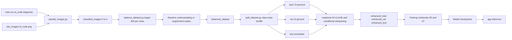
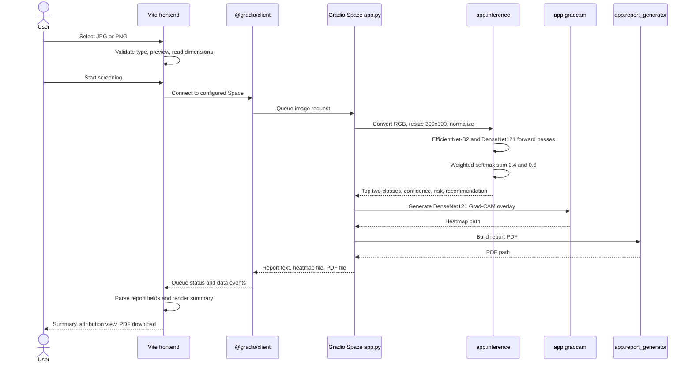

# Dataflow

## Offline dataset preparation and training

`classify_images.py` copies `<id_code>.png` to the numeric directory matching `diagnosis`. `balance_dataset.py` randomly samples larger classes down to 300 or creates augmented copies for smaller classes. `split_dataset.py` shuffles each balanced class independently and copies integer-truncated 70% / 15% / remainder slices.

Notebook 04 maps each script-generated split to its matching `enhanced_*` directory, applies `enhance_retina_image`, and saves the processed images. Notebooks 05 and 07 load those enhanced outputs. This verifies source wiring, not the contents of a current local dataset: the dataset is not included in the repository.

Because augmentation is performed before the per-file split and there is no grouping by original source file, related variants could be distributed across training and evaluation. No fixed random seed or explicit source-group leakage prevention is present. If every class has exactly 300 files, the intended totals are 1,050 train, 225 validation, and 225 test.

Run `python scripts/pipeline_summary.py` from the repository root to inspect these source mappings, local counts when data folders exist, notebook safeguards, and model artifact metadata. The CLI is read-only. Notebook 04's CLAHE and conditional sharpening are offline preprocessing and are not called during live inference.

## Real-time screening

The frontend renders an original-image view and a Grad-CAM overlay view, parses report text into structured fields, and retains the original response behind a raw-output disclosure. The Grad-CAM image is an attribution visualization and must not be interpreted as a confirmed lesion map.

## Runtime image transforms

The serving path in `app/inference.py` performs RGB conversion, resize to 300 × 300, tensor conversion, and normalization with ImageNet channel means `[0.485, 0.456, 0.406]` and standard deviations `[0.229, 0.224, 0.225]`. The inference path does not include CLAHE, a circular crop, Ben Graham preprocessing, sharpening, or corrupt-image filtering.
