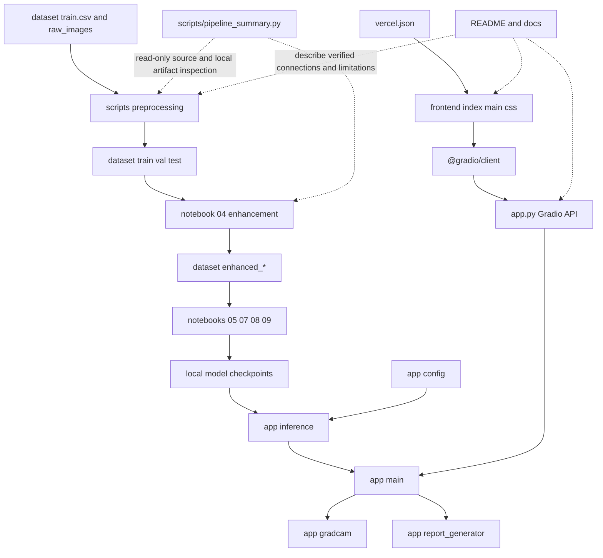

# Important files and how they connect

This map reflects the checked-in repository. Empty placeholders and ignored local artifacts are called out explicitly.

## Dependency map

## Repository root

| File or directory | Responsibility | Main dependencies / consumers |
|---|---|---|
| `.gitignore` | Excludes datasets, test samples, environment files, model/output files, and build artifacts. | Git. |
| `README.md` | Project overview, quickstart, architecture, provenance caveats, deployment pointers. | Links backend, frontend, docs. |
| `README_BACKEND.md` | Detailed preprocessing, training, inference, API, and notebook map. | `scripts/`, `notebooks/`, `app/`. |
| `scripts/pipeline_summary.py` | Read-only CLI audit of source mappings, notebook settings, local dataset counts, and model metadata. | Run from repository root with `python scripts/pipeline_summary.py`. |
| `app.py` | Gradio app, `/predict`, and local launch. | `app.main`, `app.config`. |
| `check_gpu.py` | Local CUDA availability probe. | PyTorch. |
| `requirements.txt` | Python dependency list for backend and notebooks. | Local environment / hosted backend. |
| `setup_project_structure.py` | Project directory scaffolding helper. | Filesystem paths defined in the script. |
| `vercel.json` | Installs, builds, and publishes the frontend on Vercel. | `frontend/package.json`, Vite output. |
| `.github/workflows/frontend-pages.yml` | Optional frontend build and GitHub Pages deployment. | `frontend/`, repository Actions configuration. |
| `models/` | Local EfficientNet-B2 and DenseNet121 weights when downloaded. | `app/inference.py`; ignored/untracked assets. |
| `outputs/` | Runtime heatmap, input image, and PDF destinations. | `app/main.py`, `app/gradcam.py`, `app/report_generator.py`. |
| `dataset/` | Expected local CSV and image data paths. | Preprocessing scripts and notebooks; ignored and not included in the repository. |
| `test_samples/` | Local demo image samples, if available. | Manual frontend testing; ignored and not included in the repository. |

## Backend files

### Application

| File | Responsibility |
|---|---|
| `app/__init__.py` | Python package marker. |
| `app/config.py` | Device, model checkpoint paths, ensemble weights, five class labels, risk labels, recommendations, confidence threshold, and input image size. |
| `app/inference.py` | Loads EfficientNet-B2 and DenseNet121; preprocesses the image; combines softmax probabilities; returns top two classes and report metadata. |
| `app/gradcam.py` | DenseNet121 Grad-CAM target layer, overlay, and heatmap file output. |
| `app/main.py` | Saves input, invokes prediction, invokes Grad-CAM and PDF generation, formats report text, returns three outputs. |
| `app/report_generator.py` | Builds timestamped PDF with report table, input image, heatmap, and disclaimer. |
| `app/app_utils.py`, `app/utils.py` | Empty tracked placeholders. |

### `scripts/preprocessing/`

| File | Inputs | Outputs / behavior |
|---|---|---|
| `classify_images.py` | `dataset/train.csv`, `dataset/raw_images/<id_code>.png` | Copies CSV-labeled images into `dataset/classified_images/<diagnosis>/`. |
| `balance_dataset.py` | `dataset/classified_images/` | Randomly downsamples or augments files into `dataset/balanced_dataset/`, target 300 per class. |
| `split_dataset.py` | `dataset/balanced_dataset/` | Shuffles each class and copies 70% / 15% / remainder to `dataset/train`, `dataset/val`, and `dataset/test`. |
| `count_images.py` | `dataset/classified_images/` | Read-only image counts. |
| `count_balanced_dataset.py` | `dataset/balanced_dataset/` | Read-only image counts. |

### `scripts/training/` and `scripts/utils/`

These tracked files are all zero bytes; no active implementation is present in them:

- `scripts/training/evaluate_model.py`
- `scripts/training/inference.py`
- `scripts/training/metrics.py`
- `scripts/training/test_model.py`
- `scripts/training/train_model.py`
- `scripts/utils/config.py`
- `scripts/utils/dataset_utils.py`
- `scripts/utils/image_utils.py`

Training logic instead appears in the notebooks, and production inference is in `app/inference.py`.

## Notebooks

| File | Role and connection |
|---|---|
| `notebooks/00_gpu_test.ipynb` | GPU availability test. |
| `notebooks/01_dataset_visualization.ipynb` | Displays sample images by numeric class folder. |
| `notebooks/02_dataloader_testing.ipynb` | Tests `ImageFolder`, data loaders, and 224 × 224 transforms on `train/val/test`. |
| `notebooks/03_augmentation_testing.ipynb` | Visual augmentation experiment. |
| `notebooks/04_image_quality_enhancement.ipynb` | Converts `train/val/test` into `enhanced_*` using CLAHE and conditional sharpening; not called by live inference. |
| `notebooks/05_efficientnet_training.ipynb` | EfficientNet-B2 training and TTA test evaluation using notebook 04's `enhanced_*` outputs. |
| `notebooks/06_gradcam_testing.ipynb` | Grad-CAM experiment; distinct from serving module `app/gradcam.py`. |
| `notebooks/07_densenet121_training.ipynb` | Three-phase DenseNet training; test evaluation loads the phase-2 checkpoint from notebook 04's `enhanced_*` outputs. |
| `notebooks/08_model_comparison.ipynb` | Compares both checkpoint models on `enhanced_test`. |
| `notebooks/09_ensemble_inference.ipynb` | Weighted soft-voting evaluation on `enhanced_test`. |
| `notebooks/retinascan_experimentation.ipynb` | Zero-byte file; no notebook content. |

Notebook 04 establishes the source mapping from split outputs to `enhanced_*`, which notebooks 05 and 07 consume. Run `python scripts/pipeline_summary.py` at the repository root to inspect these source references and local data/model artifact availability without modifying them.

## Frontend files

| File | Responsibility |
|---|---|
| `frontend/index.html` | Semantic page, upload/results layout, grading/disclaimer dialogs, raw report disclosure, explainability tabs. |
| `frontend/src/main.js` | Upload state, image metadata, `@gradio/client` connection, queue/cold-start status, report parsing, outputs and copy action. |
| `frontend/src/style.css` | Clinical mint palette, responsive styling, scan/result/modal animations, reduced-motion handling. |
| `frontend/package.json` | Vite scripts and `@gradio/client` runtime dependency. |
| `frontend/package-lock.json` | Locked frontend dependency versions. |
| `frontend/vite.config.js` | Vite base path from `VITE_BASE_PATH` or `./`. |
| `frontend/.env.example` | Public Space ID, endpoint name, and base path; no credentials. |
| `frontend/README.md` | Component/state architecture, API sequence, build and deployment guidance. |

## Documentation

| File | Purpose |
|---|---|
| `docs/ARCHITECTURE.md` | Offline and online component boundaries. |
| `docs/DATAFLOW.md` | Offline preparation/training and runtime image lifecycle. |
| `docs/DECISIONS.md` | Evidence-based implementation decision records and unknown original rationale. |
| `docs/PROJECT_STATUS.md` | Implemented capabilities, historical metrics, limitations, and roadmap. |
| `docs/FILE_GUIDE.md` | This repository dependency map. |
| `docs/ONBOARDING.md` | Five-minute overview, glossary, setup, and demo sample instructions. |
