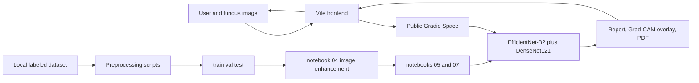

# Understand RetinaScan AI at a glance

## The five-minute mental model

1. **The browser is a static client.** Vite builds the upload and results UI; it uses `@gradio/client` to connect to the public Hugging Face Space. No HF token is required in browser code.
2. **The Space performs analysis.** Gradio accepts one image, calls the analysis pipeline, and returns a report string, a Grad-CAM overlay file, and a PDF file.
3. **Two classifiers contribute to the runtime result.** EfficientNet-B2 and DenseNet121 probabilities are combined with weights 0.4 and 0.6, respectively. Grad-CAM is generated from DenseNet121.
4. **Training is separate from serving.** Preprocessing scripts, training notebooks, and the Python Gradio app are different parts of the repository. Notebook 04 converts script-generated `train/val/test` splits into `enhanced_*` directories consumed by notebooks 05 and 07. Use the read-only CLI audit to inspect this path and local artifact availability.
5. **This is not a clinical diagnosis.** Use only for education and research triage support. A licensed ophthalmologist must confirm any screening result.



## Glossary

| Term | Meaning in this project |
|---|---|
| Fundus photograph | Image of the interior back surface of the eye, including retina and optic disc. |
| Diabetic retinopathy (DR) | Retinal disease associated with diabetes; this project uses five ordinal labels. |
| No DR / Mild / Moderate / Severe / Proliferative | Class indices 0 through 4 in `app/config.py`. |
| EfficientNet-B2 | One image-classification backbone used for inference and notebook training. |
| DenseNet121 | The second classifier; its phase-2 checkpoint is loaded by the current inference code. |
| Softmax | Converts model logits into a probability distribution over the five configured classes. |
| Weighted ensemble | Sum of DenseNet121 probabilities × 0.6 and EfficientNet-B2 probabilities × 0.4. |
| Grad-CAM | Gradient-based class activation visualization used to show model-attributed image regions. It does not confirm lesions. |
| Confidence threshold | `app/config.py` uses 65% to label prediction confidence status; it is not clinical calibration. |
| `ImageFolder` | Torchvision dataset loader that assigns classes from folder names. |
| Augmentation | Random image transformations used for training or to create additional files for minority classes. |
| Data leakage | Evaluation contamination, such as related augmented variants of one source image appearing in different splits. |
| Gradio Space | Hosted backend application and API on Hugging Face. |

## Local frontend and backend setup

### Backend

From the repository root in PowerShell, create a Python environment, install dependencies, and obtain the model files:

```powershell
py -3.10 -m venv .venv
.\.venv\Scripts\Activate.ps1
pip install -r requirements.txt
New-Item -ItemType Directory -Force models\efficientnet, models\densenet121 | Out-Null
Invoke-WebRequest https://huggingface.co/spaces/01mayankk/RetinaScanAI/resolve/main/models/efficientnet/best_efficientnet_b2.pth -OutFile models\efficientnet\best_efficientnet_b2.pth
Invoke-WebRequest https://huggingface.co/spaces/01mayankk/RetinaScanAI/resolve/main/models/densenet121/best_densenet121_phase2.pth -OutFile models\densenet121\best_densenet121_phase2.pth
python app.py
```

The local Gradio application listens on `http://127.0.0.1:7860` and registers `/predict`.

### Frontend

In another PowerShell terminal:

```powershell
cd frontend
npm ci
Copy-Item .env.example .env.local
```

For the local backend, make sure `.env.local` contains:

```dotenv
VITE_GRADIO_SPACE=http://127.0.0.1:7860
VITE_GRADIO_API_NAME=/predict
VITE_BASE_PATH=./
```

Then run `npm run dev`. Build production assets with `npm run build`; Vercel uses the repository-root `vercel.json`.

## Inspecting the ML pipeline

From the repository root, run:

```powershell
python scripts/pipeline_summary.py
```

This standard-library CLI reads preprocessing scripts, relevant notebook cells, runtime configuration, local dataset folders, and model file metadata. It reports the CSV-to-class mapping, balancing/augmentation and split settings, the verified split-to-enhanced notebook path, training safeguards, inference preprocessing, and which expected checkpoints exist. It does not modify datasets, model weights, or inference behavior. If data folders are absent, it reports their counts as unavailable.

## Testing with local sample images

If the ignored local `test_samples/` directory exists, it may contain class folders named `0_No_DR`, `1_Mild`, `2_Moderate`, `3_Severe`, and `4_Proliferative_DR`. Choose a JPG or PNG from one folder and upload it through the frontend to exercise the complete UI/API path. The folder is not committed; a fresh clone may not have it. Folder membership indicates the sample's dataset label, not a guarantee of inference correctness.

For each trial:

1. Confirm the selected file name and dimensions appear in the upload panel.
2. Start the analysis and observe the service/queue status.
3. Review the structured class, confidence, second likely class, risk, and recommendation.
4. Compare the original with the Grad-CAM overlay; interpret the overlay only as model attribution.
5. Download the PDF or copy the text summary if the API returned those outputs.
6. Do not use the output to make a medical decision; seek clinical review.

## Where to go next

- [`README.md`](../README.md): project overview and quickstart.
- [`README_BACKEND.md`](../README_BACKEND.md): exact pipeline and inference mechanics.
- [`ARCHITECTURE.md`](./ARCHITECTURE.md): component map.
- [`DATAFLOW.md`](./DATAFLOW.md): offline and online lifecycles.
- [`PROJECT_STATUS.md`](./PROJECT_STATUS.md): current capabilities and known limitations.
- [`FILE_GUIDE.md`](./FILE_GUIDE.md): file-by-file reference.
