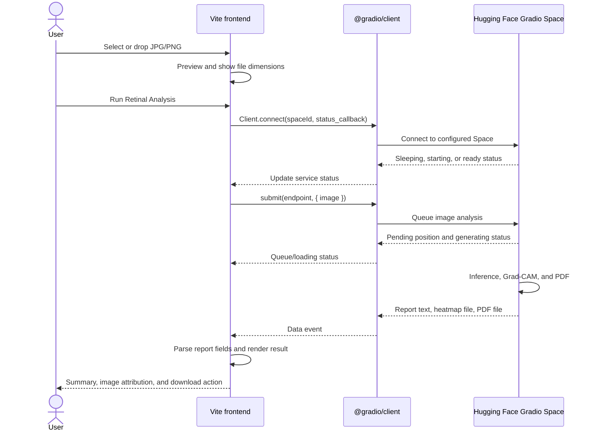

# RetinaScan AI frontend

The frontend is a static Vite application using vanilla JavaScript and `@gradio/client`. It connects directly to the public `01mayankk/RetinaScanAI` Hugging Face Space; no browser-side Hugging Face token is used or required.

## Component and state architecture

```mermaid
flowchart LR
    U[User] --> I[index.html]
    I --> F[Upload form and preview]
    I --> R[Results and clinical dialogs]
    M[src main.js]
    C[@gradio/client]
    F --> M
    R --> M
    M --> C
    C --> S[Gradio Space]
    S --> M
    M --> P[Parsed report fields]
    P --> D[Diagnosis and confidence UI]
    P --> X[Original and Grad-CAM view]
    P --> A[PDF download and copy summary]
    CSS[src style.css]
    CSS -. "styles and transitions" .-> I
```

`index.html` owns the semantic document structure, upload and result panels, two explainability tabs, raw-report disclosure, and grading/disclaimer dialogs. The user-facing screening interface does not include dataset or training methodology content; run `python scripts/pipeline_summary.py` for a concise dataset view or add `--technical` for the source audit. `src/main.js` owns file state, Gradio connection and queue status, report parsing, and rendering. `src/style.css` owns the mint clinical theme, responsive layout, focus treatment, and reduced-motion-aware transitions.

## Client-to-Hugging Face request sequence



The connected Space is public. Cold-start messages from the Gradio status callback are shown to the user. Queue events update the visible request status; queue errors and malformed outputs are shown as analysis failures rather than silently treated as success.

## Configuration and API

The Vite build reads `VITE_*` variables at build time:

| Variable | Example | Purpose |
|---|---|---|
| `VITE_GRADIO_SPACE` | `01mayankk/RetinaScanAI` | Space ID or a local Gradio URL. |
| `VITE_GRADIO_API_NAME` | `/run_analysis` | Gradio API endpoint used for analysis. |
| `VITE_BASE_PATH` | `./` | Static asset base path. |

The checked-in `.env.example` targets the public Space and `/run_analysis`. To connect to the local `app.py` instance, set `VITE_GRADIO_SPACE=http://127.0.0.1:7860` and `VITE_GRADIO_API_NAME=/predict` in an untracked `.env.local`; the local backend registers `/predict`.

The client expects three outputs in order: report text, heatmap file, and PDF file. Report parsing extracts prediction, confidence, second likely class, risk level, confidence status, and medical recommendation. The API does not return per-class probabilities; the frontend does not synthesize them.

## File-to-file map

| File | Responsibility and connections |
|---|---|
| `index.html` | Page structure, clinical information dialogs, upload form, structured report, raw-output disclosure, heatmap tabs, PDF and copy actions. Loads `src/main.js`. |
| `src/main.js` | Connects to the Space, validates image type, previews image metadata, handles drop/replace, consumes queue events, parses report text, and updates result elements. |
| `src/style.css` | Clinical mint palette, responsive panels, upload/scan states, report and heatmap cards, dialog transitions, and reduced-motion support. |
| `package.json` | `@gradio/client` runtime dependency and Vite scripts (`dev`, `build`, `preview`). |
| `package-lock.json` | Locked frontend dependency graph used by `npm ci`. |
| `vite.config.js` | Applies `VITE_BASE_PATH` or defaults to `./`. |
| `.env.example` | Public build configuration examples only; contains no secret. |
| `../vercel.json` | Vercel install/build/output configuration when `frontend/` is the project Root Directory. |
| `../.github/workflows/frontend-pages.yml` | Optional GitHub Pages build and deployment workflow. |

## Local development and production build

From `frontend/`:

```powershell
npm ci
Copy-Item .env.example .env.local
npm run dev
npm run build
```

The production bundle is written to `frontend/dist`. In Vercel, set the project Root Directory to `frontend`; `vercel.json` runs `npm ci`, `npm run build`, and publishes `dist` relative to that directory.

Never put `HF_TOKEN`, private keys, or other secrets in frontend source or public build variables. The Space ID, endpoint name, and base path are public configuration, not credentials.

## Screening limitations

The result is a research/triage aid, not a diagnosis. Grad-CAM regions show model attribution rather than verified pathology. Users should not treat confidence as calibrated clinical certainty; a licensed ophthalmologist must review and confirm any result.
